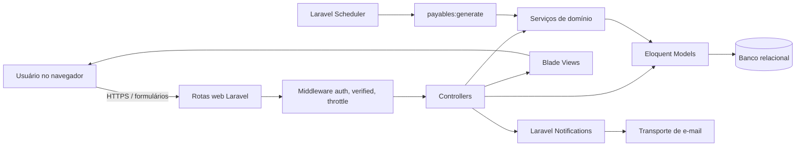
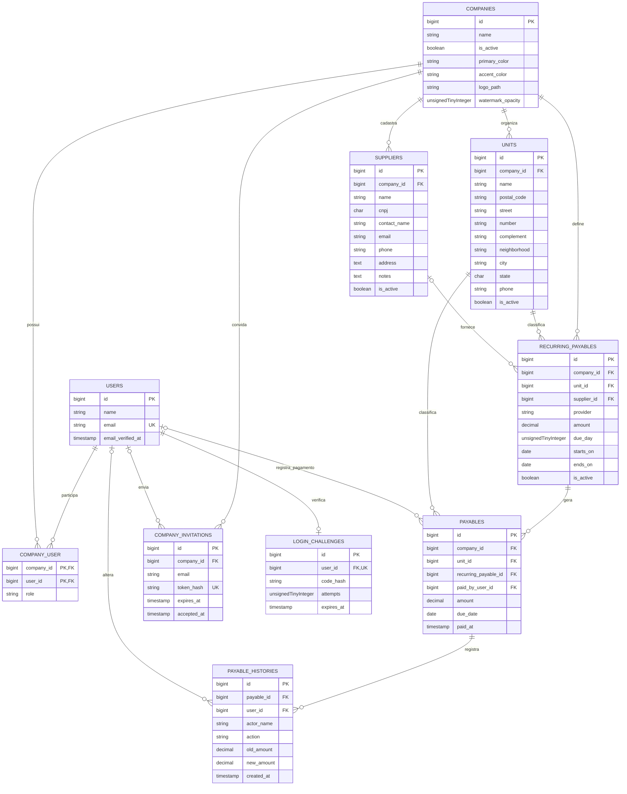
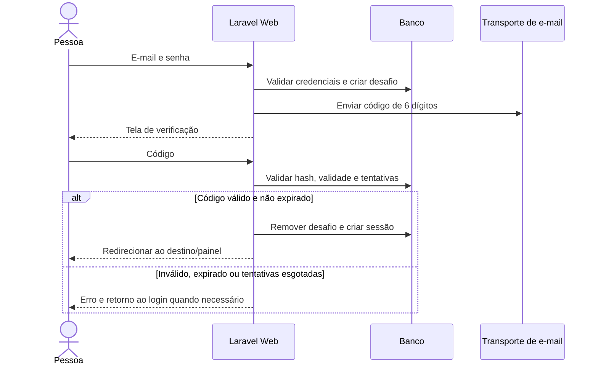
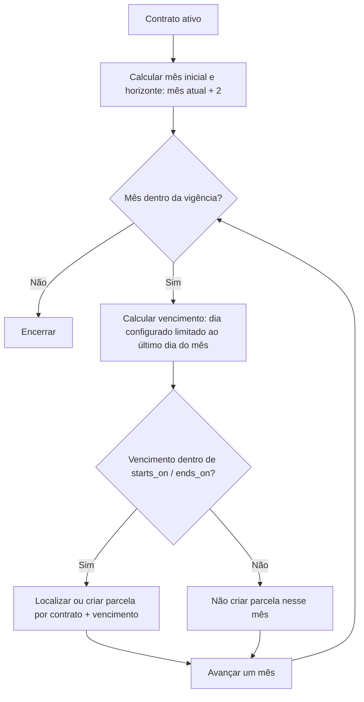

# FinControl — Especificação do Projeto

> **Documento de referência funcional, técnica e operacional**  
> **Versão:** 1.0 · **Data da linha de base:** 20/11/2026 · **Idioma:** Português (Brasil)  
> **Estado:** linha de base elaborada a partir do código disponível; metas, prazos e requisitos identificados como premissas precisam de validação pelos stakeholders.

## Como interpretar esta documentação

- **Implementado no código** descreve comportamento observado nos arquivos do projeto; não significa que houve homologação, teste de ponta a ponta ou aceite de negócio.
- **[Premissa]** identifica uma decisão ou meta sugerida porque não foi fornecida pelo solicitante.
- **A confirmar** identifica uma lacuna que exige decisão de produto, negócio ou operação.
- Os diagramas Mermaid e os wireframes são representações conceituais. Não são capturas de tela nem contratos de API.

### Identificação e fontes

| Item | Linha de base |
|---|---|
| Nome | **[Premissa] FinControl**, nome apresentado na navegação e nas telas atuais. |
| Categoria | Aplicação web de controle compartilhado de contas a pagar recorrentes. |
| Código de referência | Controllers em [app/Http/Controllers](../app/Http/Controllers), serviços em [app/Services](../app/Services), modelos em [app/Models](../app/Models), rotas em [routes](../routes) e telas em [resources/views](../resources/views). |
| Versões declaradas | PHP `^8.3`, Laravel `^13.17`; dependências front-end e testes conforme [package.json](../package.json) e [composer.json](../composer.json). |
| Ambiente conhecido | [.env.example](../.env.example) sugere SQLite, sessão/cache/fila em banco e transporte de e-mail `log`; isso é referência de desenvolvimento, não configuração de produção. |
| Estado de implantação | **A confirmar.** Não há evidência nesta especificação de ambiente produtivo, SLA, volume, orçamento ou equipe contratada. |

---

## 1. Visão geral e objetivos

### 1.1 Problema

Empresas com mais de uma unidade precisam manter visibilidade sobre compromissos recorrentes, datas de vencimento, pagamentos realizados e valores pendentes. Controlar esses dados por planilhas ou mensagens dificulta a identificação de atrasos, a distribuição de responsabilidades e a leitura consolidada por unidade.

### 1.2 Proposta de valor

Centralizar em um espaço compartilhado por empresa:

1. os contratos que originam compromissos mensais;
2. as parcelas previstas em uma janela móvel de três meses;
3. o status e o valor de cada conta;
4. os totais gerais e por unidade;
5. o acesso de proprietários e membros convidados.

O FinControl registra e acompanha contas. **Não executa pagamentos bancários nem substitui um sistema contábil.**

### 1.3 Objetivos do produto

- Reduzir lançamentos repetitivos de despesas mensais por meio da geração automática de parcelas.
- Dar visibilidade sobre montantes em aberto, a vencer, pagos no mês e vencidos.
- Permitir que membros autorizados acompanhem e atualizem contas da empresa.
- Separar os dados e as operações por empresa ativa e unidade.
- Tornar explícitos os casos de vencimento, pagamento, convite expirado e geração duplicada.

### 1.4 Stakeholders e personas

| Persona / stakeholder | Necessidade principal | Capacidades observadas |
|---|---|---|
| Proprietário da empresa | Configurar o espaço e controlar acesso da equipe. | Criar empresa, gerenciar unidades, convidar membros e consultar/operar contas. |
| Membro da empresa | Acompanhar compromissos financeiros e atualizar pagamentos. | Consultar e operar contas e unidades da empresa; não pode convidar pessoas. |
| Responsável financeiro/operacional | Identificar vencimentos e priorizar pagamentos. | **[Premissa]** Atua como membro; não existe papel especializado de financeiro no modelo atual. |
| Usuário convidado | Acessar uma empresa com identidade validada. | Aceitar convite enviado para o seu e-mail, se estiver autenticado com esse mesmo endereço. |
| Gestor / patrocinador | Acompanhar adoção, riscos e resultado do produto. | **[Premissa]** Consome indicadores operacionais a definir; não há painel de gestão separado. |
| Equipe de desenvolvimento/operação | Manter aplicação, dados, e-mail, scheduler e documentação. | Operação técnica conforme ambiente e processos a serem definidos. |

### 1.5 Indicadores de sucesso (KPIs)

Não há evidência de telemetria de produto, metas aprovadas ou histórico de baseline. Os valores abaixo são **[Premissa] metas iniciais para discussão**, e não resultados medidos.

| KPI proposto | Definição / cálculo | Meta inicial [Premissa] | Instrumentação / fonte |
|---|---|---:|---|
| Parcelas geradas sem duplicidade | Parcelas recorrentes únicas por contrato e vencimento ÷ parcelas geradas. | 100% | Restrição única já existe no banco; monitorar falhas de execução. |
| Execuções diárias concluídas | Execuções do comando `payables:generate` concluídas ÷ execuções esperadas. | ≥ 99% ao mês | Log estruturado, alerta e histórico do scheduler; ainda a estabelecer. |
| Cobertura de geração | Contratos ativos com parcelas existentes até o horizonte esperado ÷ contratos ativos elegíveis. | ≥ 99% | Comparação periódica entre contratos e parcelas; ainda a estabelecer. |
| Redução de contas vencidas | Variação da quantidade/valor vencido contra baseline definido no piloto. | Redução ≥ 20% após 90 dias | Baseline do piloto e série temporal; não disponível atualmente. |
| Tempo de resposta de telas principais | Percentil 95 das requisições do painel e da listagem. | ≤ 2 s sob carga acordada | APM/teste de carga; **[Premissa]** capacidade e perfil de carga a definir. |
| Convites aceitos | Convites aceitos ÷ convites válidos enviados. | Definir após piloto | Eventos de convite e aceite; hoje o banco registra estados, sem painel analítico. |

**Critério de gestão:** antes de assumir compromissos, aprovar definição, fonte, periodicidade, responsável e baseline de cada KPI. Não interpretar a interface atual como instrumento de auditoria ou monitoramento de SLA.

### 1.6 Premissas e restrições

- **[Premissa]** O produto é destinado inicialmente a empresas brasileiras e apresenta moeda em reais (R$).
- **[Premissa]** A aplicação é entregue como monólito Laravel com renderização server-side; o navegador é o cliente principal.
- Há um contexto de empresa ativa na sessão. O modelo atual suporta vários vínculos de usuário-empresa.
- Os endpoints de negócio exigem autenticação e, na maioria das rotas, verificação de e-mail.
- O agendador precisa estar ativo para que a geração diária além da criação imediata do contrato seja executada.
- O modelo de dinheiro usa `decimal(12,2)`; a validação de formulário limita o valor a `9.999.999.999,99`.
- **A confirmar:** moeda e fuso horário oficiais, jurisdição e política de retenção/exclusão de dados.
- **A confirmar:** provedores de e-mail, banco, hospedagem, backups, RPO/RTO, SLA, orçamento, quantidade de empresas/usuários e equipe disponível.
- **A confirmar:** requisitos regulatórios, trilha de auditoria, aprovação dupla, anexos e exportações.

---

## 2. Escopo e personas

### 2.1 Escopo funcional atual

1. **Identidade e acesso:** cadastro, login, validação por código de seis dígitos enviado por e-mail, verificação de endereço, recuperação de senha, perfil e saída.
2. **Empresas e contexto:** criar e alternar empresas; o proprietário pode arquivar uma empresa com confirmação de senha, suspendendo o acesso da equipe sem apagar os dados, e reativá-la pelo seletor.
3. **Unidades:** cadastrar e editar unidades/sedes com endereço brasileiro (CEP, rua, número, complemento, bairro, cidade, UF e telefone); arquivar ou reativar sem apagar contratos e parcelas.
4. **Fornecedores:** manter cadastro independente por empresa com nome obrigatório e CNPJ, contato, e-mail, telefone, endereço e observações opcionais; arquivar ou reativar preservando os vínculos.
5. **Equipe:** busca de usuários cadastrados e envio de convites por e-mail, aceitação autenticada e registro de papel proprietário/membro.
6. **Contratos recorrentes:** cadastrar descrição, fornecedor e unidade ativos da empresa, valor mensal, dia de vencimento, início e término opcional; pausar/retomar geração.
7. **Parcelas:** gerar ocorrências mensais até três meses à frente, editar o valor da ocorrência, marcar como paga, confirmar antes de reabrir e consultar o histórico de alteração do valor e do status, com responsável e data.
8. **Consulta:** pesquisar descrição, fornecedor ou unidade; filtrar por status; paginar resultados. Unidades arquivadas permanecem disponíveis nos filtros históricos.
9. **Painel:** apresentar totais globais e por unidade e uma lista curta de próximos vencimentos.
10. **Identidade visual:** proprietário configura cores, logo e opacidade da marca d’água; as alterações são compartilhadas no espaço autenticado da empresa.
11. **Aparência:** alternar entre modo claro e noturno em qualquer tela; a preferência é salva no navegador e, sem escolha manual, segue o tema do sistema.

### 2.2 Fora de escopo nesta linha de base

Os itens abaixo não aparecem como funcionalidade implementada no código examinado. São **fora de escopo da fase descrita**, salvo aprovação de mudança:

- Iniciar ou liquidar pagamentos, conectar a bancos, cartões, PIX, Open Finance ou gateways.
- Contabilidade, contas a receber, faturamento, orçamento, centro de custo ou conciliação bancária.
- Emissão fiscal, importação automática de notas/faturas, anexos ou armazenamento de comprovantes.
- Exportação para CSV/PDF/Excel, relatórios customizados ou integração com ERP.
- Aprovação de pagamentos, limites por usuário, permissões granulares ou papel dedicado de contador.
- Notificações de vencimento, lembretes de atraso ou alertas financeiros ao usuário final.
- Gestão de contratos não mensais, pagamentos parciais, parcelamento manual, juros, multas ou recorrência semanal/anual.
- Auditoria de alterações em contratos/equipe e trilha de eventos financeiros além das mudanças de valor e status das parcelas.
- Administração global de tenants, suporte interno, cobrança por assinatura e planos SaaS.
- Aplicativo móvel nativo e API pública para terceiros.

Qualquer inclusão exige análise de impacto em interface, modelo de dados, autorização, requisitos, testes, operação e cronograma.

### 2.3 Matriz de permissões observada

| Ação | Proprietário | Membro |
|---|:---:|:---:|
| Consultar painel, contas, contratos, empresa e unidades | Sim | Sim |
| Criar/alternar entre empresas ativas de que participa | Sim | Sim |
| Arquivar empresa e reativar empresa arquivada | Sim | Não |
| Cadastrar, editar, arquivar e reativar unidade ou fornecedor | Sim | Sim |
| Alterar cores, logo e marca d’água da empresa | Sim | Não |
| Criar contrato, ajustar parcela, marcar paga/reabrir | Sim | Sim |
| Pesquisar usuários para convite | Sim | Não |
| Enviar convite à equipe | Sim | Não |
| Aceitar convite para outra empresa | Sim, se convidado | Sim, se convidado |
| Administrar papéis ou remover outro membro | Não implementado | Não implementado |

**Observação:** a aplicação atualmente usa dois papéis (`owner` e `member`). A lista não é um sistema completo de autorização granular. Usuários não proprietários têm acesso operacional amplo às contas da empresa.

### 2.4 Fluxos principais

#### Fluxo A — primeiro acesso

1. Visitante cria usuário com nome, e-mail e senha.
2. A aplicação envia a verificação de endereço pelo fluxo padrão do Laravel.
3. Usuário informa e-mail e senha na tela de login.
4. Após autenticação inicial, o sistema cria um desafio e envia um código de seis dígitos por e-mail.
5. Usuário informa o código em até 10 minutos; são permitidas até cinco tentativas inválidas.
6. Sessão autenticada é criada; o acesso ao painel exige também endereço verificado.
7. Sem empresa, o painel solicita a criação do primeiro espaço.

#### Fluxo B — cadastrar e acompanhar uma despesa recorrente

1. Usuário cria ou atualiza uma unidade e cadastra o fornecedor para a empresa.
2. Informa contrato, selecionando um fornecedor e uma unidade ativos, além do valor, dia de vencimento e vigência.
3. O sistema gera as parcelas elegíveis até o fim do mês atual mais dois meses.
4. A listagem apresenta parcelas e contratos; os totais são recalculados a partir dos dados.
5. Usuário ajusta valor individual ou marca uma conta como paga; cada alteração de valor e transição de pagamento fica registrada na parcela com responsável e horário.
6. O vencimento é classificado automaticamente como pendente ou em atraso; pagamento prevalece sobre a data.

#### Fluxo E — personalizar o espaço da empresa

1. Proprietário escolhe cor principal, cor de destaque, logo e opacidade da marca d’água.
2. O sistema valida e armazena as preferências na empresa ativa; a própria logo é usada no menu, no cabeçalho da modal de parcelas e como marca d’água.
3. Membros veem a identidade compartilhada, mas não podem alterá-la.

#### Fluxo C — compartilhar empresa

1. Proprietário pesquisa pessoa cadastrada ou digita e-mail.
2. Sistema valida a autorização, registra/atualiza convite e envia link com token.
3. O convidado autentica-se com o e-mail exato do convite (comparação sem distinção entre maiúsculas/minúsculas).
4. Se válido e não expirado, aceita convite; transação associa usuário como membro e ativa a empresa na sessão.

#### Fluxo D — alternar empresa

1. Usuário seleciona empresa de que já participa.
2. O servidor valida o vínculo e grava o identificador da empresa na sessão.
3. Painel e consultas subsequentes são resolvidos para essa empresa; seleção não autorizada é rejeitada.

---

## 3. Arquitetura e componentes

### 3.1 Visão lógica



### 3.2 Camadas e responsabilidades

| Componente | Responsabilidade | Referências do projeto |
|---|---|---|
| Rotas web | Definem páginas, operações POST/PATCH e middlewares. | [routes/web.php](../routes/web.php), [routes/auth.php](../routes/auth.php), [routes/console.php](../routes/console.php) |
| Controllers | Validam requisições, aplicam escopo da empresa, coordenam serviços e retornam Blade/redirect/erros HTTP. | [app/Http/Controllers](../app/Http/Controllers) e [app/Http/Controllers/Auth](../app/Http/Controllers/Auth) |
| Serviços | Centralizam geração de parcelas e agregações do painel. | [RecurringPayableGenerator.php](../app/Services/RecurringPayableGenerator.php), [PayableSummary.php](../app/Services/PayableSummary.php) |
| Modelos Eloquent | Representam usuário, empresa, unidade, contrato, parcela, desafio de login e convite. | [app/Models](../app/Models) |
| Views | Renderizam páginas e formulários com Blade. | [dashboard.blade.php](../resources/views/dashboard.blade.php), [resources/views/payables](../resources/views/payables), [resources/views/companies](../resources/views/companies), [resources/views/auth](../resources/views/auth) |
| Front-end | Estilos Tailwind, compilação Vite e interatividade leve Alpine.js. | [resources/css](../resources/css), [resources/js](../resources/js), [vite.config.js](../vite.config.js) |
| Persistência | Relacionamentos, índices, chaves estrangeiras, unicidade de recorrências e valores decimais. | [database/migrations](../database/migrations) |
| Notificações | Envio de código de login e convite por e-mail. | [app/Notifications](../app/Notifications) |
| Execução periódica | Gera parcelas pendentes diariamente às 01:00, sem sobreposição agendada. | [routes/console.php](../routes/console.php), [GenerateUpcomingPayables.php](../app/Console/Commands/GenerateUpcomingPayables.php) |

### 3.3 Diagrama de dados conceitual



**Integridade relevante:** empresas, unidades e fornecedores são arquivados em vez de excluídos pela interface. Apenas o proprietário pode arquivar/reativar uma empresa; o arquivamento exige senha, suspende o acesso de todos os membros e mantém contratos, parcelas, históricos, convites e identidade visual. Empresas arquivadas não geram parcelas e convites pendentes não podem ser aceitos; o proprietário pode reativar pelo seletor. Unidades têm nome único por empresa; fornecedores são isolados por empresa e CNPJ, quando informado, é único nessa empresa. Fornecedores e unidades arquivados não podem ser usados em novos contratos, mas permanecem disponíveis para consulta histórica. A migração cria um fornecedor por nome de fornecedor legado em cada empresa e liga os contratos existentes; o nome gravado em cada parcela permanece como fotografia histórica. Associação empresa-usuário tem chave composta; convites são únicos por empresa/e-mail; parcelas são únicas por contrato/data de vencimento.

### 3.4 Fluxos de dados técnicos

#### Autenticação em duas etapas por e-mail



#### Geração de parcelas recorrentes



O serviço é acionado ao cadastrar contrato e pelo comando diário. A chave única no banco torna repetida a execução segura contra duplicidade; pausar contrato impede novas gerações, sem apagar as parcelas já existentes.

### 3.5 Decisões técnicas observadas e implicações

- **Monólito MVC:** interface Blade e regras no servidor; não há API pública identificada.
- **Isolamento por empresa ativa:** consultas de contas e contratos partem do relacionamento da empresa corrente. Não há evidência de bancos ou schemas separados por empresa.
- **Autorização mista:** middleware exige usuário e e-mail verificado nas rotas de negócio; operações de convite também verificam o papel de proprietário. A maioria das operações financeiras está disponível para qualquer membro da empresa.
- **Fila e e-mail:** [.env.example](../.env.example) define fila em banco e e-mail em `log`, mas as notificações observadas não são enfileiradas explicitamente. A operação real depende do transporte configurado.
- **Agendamento:** frequência diária às 01:00 com `withoutOverlapping`; não há evidência nesta linha de base de alertas de falha ou monitoramento do scheduler.
- **Idempotência:** `firstOrCreate` associado à unicidade `recurring_payable_id + due_date`.
- **Valores:** persistidos como decimal; apresentação usa formatação brasileira e R$.
- **Estado de pagamento:** `paid_at` e `paid_by_user_id` representam o estado atual; as alterações de valor e transições de pagamento também são registradas em `payable_histories`, com ator e horário.
- **Identidade visual:** cores, logo e opacidade são configuradas por empresa. A logo é um ativo público de marca e só aceita PNG, JPEG ou WebP de até 2 MB; não enviar imagens com informação confidencial.
- **Autenticação:** desafio de login armazena hash do código, expira em 10 minutos e limita a cinco tentativas. O código é enviado por e-mail.

### 3.6 Mapa de telas

| Tela | Rota principal | Conteúdo e ações |
|---|---|---|
| Página pública | `/` | Apresentação e acesso a cadastro/login. |
| Cadastro / Login / Verificação | `/register`, `/login`, `/login/verify` | Identidade, credenciais e código enviado por e-mail em layout público responsivo compartilhado. |
| Visão geral | `/dashboard` | Cabeçalho em destaque, cartões financeiros, próximos vencimentos, totais por unidade ou formulário inicial para criar empresa. |
| Contas a pagar | `/payables` | Cabeçalho destacado, resumo, totais por unidade, cadastro de contrato, pausa/retomada, busca, filtros, parcelas, pagamentos e histórico de alterações por parcela. |
| Empresa | `/company` | Cabeçalho da empresa, cadastrar unidades e fornecedores, ajustar identidade visual, listar equipe, procurar/convidar usuários e, para o proprietário, arquivar a empresa mediante senha. |
| Aceitar convite | `/company-invitations/{token}` | Resumo da empresa e aceite autenticado do convite. |
| Perfil | `/profile` | Cabeçalho da conta, atualizar perfil/senha e excluir conta. |
| Ajuda e documentação | `/help` | Guia prático de empresas, unidades, contratos, parcelas, equipe e perfil, acessível a partir do perfil. |
| Aparência | Global | Alternância entre modo claro e noturno, com preferência salva no navegador. |

### 3.7 Wireframes conceituais

#### Visão geral / painel

```text
+-----------------------------------------------------------------------+
| FinControl     Visão geral   Contas a pagar   Empresa   [Perfil]      |
+-----------------------------------------------------------------------+
| Painel financeiro                         [mês / ano] [Contas a pagar]|
| Olá, [nome]                                                          |
| Acompanhe os compromissos financeiros da [empresa]                   |
|                                                                       |
| [ Total em aberto ] [ A vencer ] [ Pagas neste mês ] [ Em atraso ]   |
|                                                                       |
| Próximos vencimentos                        | Totais por unidade      |
| [dia] Descrição / fornecedor / unidade      | Unidade                 |
|        Status                         Valor  | Em aberto / pagas / atraso |
| ...                                          | ...                     |
+-----------------------------------------------------------------------+
```

#### Contas a pagar

```text
+-----------------------------------------------------------------------+
| Gestão financeira                          [Gerenciar equipe]         |
| Contas a pagar — [empresa]                                           |
| [Total em aberto] [A vencer] [Pagas no mês] [Em atraso]              |
| Resumo por unidade: cartões responsivos com contagem de contratos e totais |
|                                                                       |
| Novo contrato (4 colunas)       | Contratos e parcelas (8 colunas)   |
| descrição, fornecedor           | [Busca] [Status] [Unidade] [Filtrar]|
| unidade, valor, vencimento      | contrato / unidade / valor          |
| início, término                 | [Pausar / Ver parcelas]             |
| [Cadastrar contrato]            |                                     |
+-----------------------------------------------------------------------+
```

#### Empresa e equipe

```text
+-----------------------------------------------------------------------+
| Espaço da empresa: [nome] [unidades] [membros]                        |
| Identidade visual: [Cor principal] [Cor de destaque] [Logo]           |
| [Opacidade da marca d’água__________] [Prévia] [Salvar]                |
|                                                                       |
| [Criar outra empresa]               | [Unidades e sedes]              |
| [Nome________________] [Criar]      | [Dados de endereço e contato]   |
|                                      | [Adicionar] [Editar / arquivar] |
| [Fornecedores] cadastro e detalhes  | [Editar / arquivar / reativar]  |
| [Convidar equipe]                   | [Membros da empresa]            |
| [Buscar usuário por nome/e-mail]    | [Lista rolável de membros]      |
| [E-mail________________] [Enviar]   |                                 |
| Convites pendentes                  |                                 |
+-----------------------------------------------------------------------+
```

#### Perfil e telas de acesso

```text
Perfil:
| Cabeçalho em destaque: Meu perfil                                    |
| [Avatar] [Nome / e-mail] [Status de verificação]                     |
| [Informações pessoais]            | [Segurança e senha]               |
| [Excluir conta — área de risco, separada dos formulários]              |

Cadastro / login / recuperação:
| FinControl                         | [Título e descrição da tela]     |
| Compromissos e unidades organizados| [Formulário responsivo]          |
|                                     | [Ação principal]                 |
| Em telas estreitas, a marca e o formulário ficam em um cartão único.  |

Ajuda e documentação:
| Índice lateral/rolável             | Primeiros passos                 |
|                                    | Contratos e parcelas             |
|                                    | Empresa, equipe e perfil         |
```

---

## 4. Requisitos funcionais e não funcionais

Prioridades: **P0** = essencial para operação do escopo atual; **P1** = importante para segurança/qualidade operacional; **P2** = evolução recomendada. “Implementado no código” não significa aceite de produção.

### 4.1 Requisitos funcionais

| ID | Prioridade | Requisito / situação observada | Critérios de aceite |
|---|---|---|---|
| RF01 | P0 | Criar conta com nome, e-mail único e senha confirmada; **implementado no código**. | Dados inválidos não criam conta; e-mail deve estar em minúsculas e ser único; cadastro encaminha para login e fluxo de verificação. |
| RF02 | P0 | Autenticar por senha e código de e-mail de seis dígitos; **implementado no código**. | Código correto, vigente e ligado à sessão conclui login; código inválido não autentica; desafio expira em 10 min e deixa de valer após cinco tentativas inválidas. |
| RF03 | P0 | Criar, alternar e arquivar empresas; **implementado no código**. | Criador vira proprietário; empresa escolhida deve pertencer ao usuário; apenas proprietário arquiva com senha; arquivamento mantém dados e suspende acesso; proprietário reativa pelo seletor. |
| RF04 | P0 | Cadastrar, editar e arquivar unidade da empresa ativa; **implementado no código**. | Nome obrigatório e único dentro da empresa; campos de endereço e telefone são opcionais; CEP aceita oito dígitos com máscara; UF aceita duas letras; arquivamento é reversível, preserva referências e impede novos contratos. |
| RF05 | P0 | Convidar membro para a empresa; **implementado no código**. | Apenas proprietário pesquisa/convida; convite associa e-mail normalizado, token não armazenado em texto puro e validade de sete dias. |
| RF06 | P0 | Aceitar convite; **implementado no código**. | Usuário autenticado com o mesmo e-mail do convite e token válido é associado como membro; convite é consumido em transação e empresa passa a ativa. |
| RF07 | P0 | Cadastrar contrato recorrente; **implementado no código**. | Descrição obrigatória; fornecedor e unidade devem estar ativos e pertencer à empresa ativa; valor positivo com até duas casas; dia entre 1 e 31; término não anterior ao início. |
| RF08 | P0 | Gerar parcelas mensais para contratos elegíveis; **implementado no código**. | Geração contempla início e janela até mês atual + 2; vigência é inclusiva; dia 31 ajusta ao último dia do mês; repetir operação não duplica parcela. |
| RF09 | P0 | Pausar e retomar contrato; **implementado no código**. | Pausado não gera novas parcelas; parcelas anteriores permanecem; retomar volta a gerar dentro da vigência e sem duplicar. |
| RF10 | P0 | Consultar, pesquisar, filtrar e paginar contas; **implementado no código**. | Busca considera descrição, fornecedor e unidade; filtros incluem todos, a vencer, pagas e atrasadas; listagem mostra 20 registros por página e mantém filtros ao paginar. |
| RF11 | P0 | Ajustar valor de uma parcela; **implementado no código**. | Valor maior que zero, limitado a duas casas e ao máximo definido; apenas parcela da empresa ativa pode ser alterada. |
| RF12 | P0 | Marcar conta como paga ou reabrir; **implementado no código**. | Marcar registra instante e usuário; a interface confirma antes de reabrir, o que limpa ambos os campos; atualização só alcança conta da empresa ativa. |
| RF13 | P0 | Exibir resumo geral e por unidade; **implementado no código**. | Painel calcula aberto, a vencer, pago no mês e em atraso; totais correspondem a parcelas e à data corrente; lista até seis próximos vencimentos pendentes. |
| RF14 | P0 | Gerar parcelas diariamente; **implementado no código; operação externa depende do scheduler**. | Agendamento chama `payables:generate` diariamente às 01:00; não inicia execução sobreposta; comando informa quantidade criada; contratos de empresas arquivadas não geram parcelas. |
| RF15 | P1 | Atualizar perfil e excluir conta com confirmação de senha; **implementado no código**. | E-mail alterado perde marcação de verificado; exclusão exige senha; propriedade é transferida para membro remanescente ou empresa sem membros é removida. |
| RF16 | P1 | Personalizar identidade visual da empresa; **implementado no código**. | Apenas proprietário altera cores, logo e opacidade; tema aparece para membros no espaço autenticado; logo aceita PNG/JPEG/WebP até 2 MB; opacidade de 0 a 30%; remoção ou substituição limpa o arquivo anterior. |
| RF17 | P0 | Cadastrar, editar e arquivar fornecedores por empresa; **implementado no código**. | Nome obrigatório; CNPJ, contato, e-mail, telefone, endereço e observações opcionais; CNPJ normalizado e único por empresa; arquivamento reversível preserva contratos vinculados. |
| RF18 | P0 | Selecionar fornecedor cadastrado no contrato recorrente; **implementado no código**. | Apenas fornecedor ativo da empresa pode ser selecionado; alteração do fornecedor atualiza o contrato e as próximas parcelas, sem reescrever o nome histórico já gravado nas parcelas existentes. |
| RF19 | P1 | Arquivar e reativar empresa; **implementado no código**. | Apenas proprietário pode arquivar e deve confirmar a senha atual; a equipe perde acesso, dados e convites permanecem guardados, convites não são aceitos durante o arquivamento e a empresa pode ser reativada pelo seletor. |
| RF20 | P1 | Alternar o tema visual; **implementado no código**. | Controle de tema disponível nas telas públicas, de autenticação e autenticadas; preferência manual persiste no navegador, e a preferência do sistema é usada antes da primeira escolha. |

### 4.2 Requisitos não funcionais

| ID | Prioridade | Requisito / estado | Critérios de aceite |
|---|---|---|---|
| RNF01 | P0 | Isolamento entre empresas; **implementado por escopo de relacionamento, a validar por testes de segurança**. | Usuário não lê nem altera unidade, contrato, convite ou parcela de empresa alheia; requests cruzados retornam recusa e não alteram dados. |
| RNF02 | P0 | Proteção de autenticação; **controles parciais no código**. | Senhas seguem hash do framework; código não é persistido em texto puro; expiração, limite de tentativas e throttling permanecem cobertos por testes. |
| RNF03 | P0 | Integridade e idempotência financeira; **restrições presentes no schema**. | Valores mantêm precisão decimal; chaves únicas e estrangeiras impedem duplicação/órfãos conforme as regras; alterações transacionais não deixam estado parcial. |
| RNF04 | P1 | Desempenho de telas; **meta a confirmar**. | **[Premissa]** P95 ≤ 2 s para painel/listagem em carga representativa aprovada; paginação impede carregamento ilimitado. |
| RNF05 | P1 | Compatibilidade responsiva e acessibilidade; **layout responsivo aparente; conformidade não auditada**. | Operações essenciais funcionam em celular e desktop; campos têm rótulos, erros são apresentados e fluxos principais podem ser usados por teclado; **[Premissa]** objetivo WCAG 2.2 AA. |
| RNF06 | P1 | Disponibilidade e recuperação; **não definido**. | Aprovar SLA, backups, retenção, RPO/RTO e teste de restauração antes de produção; configuração de ambiente é documentada sem expor segredos. |
| RNF07 | P1 | Observabilidade; **lacuna operacional a fechar**. | Execução agendada, falha de e-mail e erro de aplicação são rastreáveis; alertas têm responsável e procedimento de resposta. |
| RNF08 | P1 | Manutenibilidade e regressão; **fundação presente**. | Mudanças críticas têm teste automatizado adequado; migrations são reversíveis quando possível; documentação compatível com a versão implantada. |
| RNF09 | P1 | Governança documental; **regra definida neste documento**. | Mudança de requisito, fluxo, tela, dado, integração, segurança ou operação revisa este documento e o README na mesma entrega. |
| RNF10 | P2 | Escalabilidade; **limites e capacidade não definidos**. | Antes de ampliar volume, medir consultas/agregações, frequência do scheduler, conexões e infraestrutura contra perfil aprovado. |
| RNF11 | P1 | Segurança de ativos de marca; **implementado no código**. | Uploads exigem autenticação, papel de proprietário, validação de tipo/tamanho e não aceitam SVG; arquivos ficam no disco público apenas por serem imagens de marca. |

---

## 5. Regras de negócio e casos de borda

### 5.1 Empresas e autorização

1. Uma pessoa pode participar de múltiplas empresas; o contexto ativo é mantido na sessão.
2. Ao criar empresa, o usuário criador recebe papel `owner`; aceite de convite cria papel `member`.
3. Se a empresa ativa registrada na sessão não pertencer mais ao usuário, o método de resolução tenta a primeira empresa associada por identificador.
4. Qualquer membro pode operar contas da empresa. Somente proprietário pode pesquisar usuários e emitir convites.
5. O escopo das consultas deve sempre começar pela empresa ativa. IDs enviados pelo navegador não substituem a validação de pertencimento.
6. Ao excluir conta, a propriedade de cada empresa é transferida ao membro remanescente de menor ID; se não houver sucessor, a empresa é excluída.
7. Não existe fluxo administrativo para remover membro ou transferir propriedade manualmente além da regra de exclusão de conta.
8. A identidade visual pertence à empresa ativa e é compartilhada com todos os membros. Somente proprietários podem alterá-la; ao excluir o último proprietário e a empresa, a logo armazenada também é removida.

### 5.2 Convites

1. E-mail é normalizado para minúsculas; um usuário já associado à empresa não pode ser convidado novamente.
2. Convite é único por empresa/e-mail. Reenvio para o mesmo endereço atualiza token, remetente, expiração e estado de aceite do convite existente.
3. Token tem 64 caracteres aleatórios; somente seu hash SHA-256 é armazenado. Link válido expira em sete dias.
4. Convite aceito, expirado ou token inexistente não pode ser utilizado novamente.
5. E-mail autenticado deve corresponder ao e-mail convidado, sem distinção de caixa; divergência retorna acesso negado.
6. Busca de usuário requer pelo menos dois caracteres e limita resultados a oito. Busca e envio têm limites de requisição por rota.
7. Falha de entrega do e-mail depende do transporte configurado; ambiente `log` não entrega mensagens a uma caixa real.

### 5.3 Contratos e parcelas

1. Valor deve ser maior que zero e ter até duas casas decimais; limites de formulário e precisão de banco devem permanecer consistentes.
2. `due_day` varia de 1 a 31. Para mês mais curto, o vencimento usa o último dia existente (por exemplo, dia 31 em fevereiro vira dia 28 ou 29).
3. A primeira ocorrência só é criada se a data calculada for igual ou posterior a `starts_on`.
4. Se `ends_on` estiver preenchido, a data de vencimento precisa ser igual ou anterior a ele; o mês final é inclusivo.
5. A janela de geração termina no último dia do segundo mês seguinte ao mês corrente, totalizando até três meses de calendário.
6. Alteração de valor de uma parcela não modifica automaticamente contrato nem demais parcelas.
7. Pausar contrato impede novas parcelas, mas não cancela parcelas existentes. Como o gerador percorre a vigência desde `starts_on`, retomar (ou executar a rotina diária após uma falha) pode criar parcelas ausentes de meses anteriores, inclusive já vencidos, dentro do horizonte elegível; a unicidade impede duplicações. **A confirmar:** esse comportamento de recuperação retroativa é desejado ou meses perdidos devem ser ignorados?
8. Uma parcela recorrente é identificada para unicidade pelo contrato e data de vencimento.
9. **A confirmar:** mudança de valor/data/unidade de um contrato deve afetar apenas novas parcelas ou também as existentes? Não há edição do contrato implementada nesta linha de base.
10. Alterações no valor e ações de marcar paga/reabrir criam eventos com valores anterior/novo quando aplicável, nome do responsável e horário. A trilha só cobre ações feitas após a implantação; alterações anteriores não podem ser reconstruídas.

### 5.4 Estados da conta e indicadores

| Condição | Estado exibido | Efeito em totais |
|---|---|---|
| `paid_at` preenchido | Paga | Não compõe aberto/a vencer/em atraso; compõe pago no mês se quitada no mês corrente. |
| Não paga e vencimento anterior a hoje | Em atraso | Compõe aberto e em atraso. |
| Não paga e vencimento hoje ou futuro | Pendente / a vencer | Compõe aberto e a vencer. |

- O estado **paga prevalece** sobre vencimento já passado.
- Um vencimento na data corrente continua pendente; só passa a atraso no dia seguinte segundo o relógio/fuso da aplicação.
- “Pagas neste mês” considera `paid_at` dentro do mês calendário corrente.
- Os valores agregados vêm das parcelas, não da soma nominal dos contratos.
- Reabrir uma conta limpa data e usuário no estado atual, preservando a transição e o responsável no histórico da parcela.

### 5.5 Tratamento de erros esperado

| Situação | Comportamento observado/esperado |
|---|---|
| Campo inválido | Validação impede persistência e devolve erros junto ao formulário. |
| Empresa, unidade ou parcela fora do escopo | Recurso não é encontrado no relacionamento autorizado (tipicamente 404). |
| Ação exclusiva de proprietário por membro | Acesso negado (403). |
| Convite com token inválido/expirado/consumido | Convite não é localizado como válido. |
| E-mail diferente do destinatário do convite | Acesso negado; convite não é aceito. |
| Código inválido de login | Erro no campo; tentativa incrementada. Ao atingir cinco tentativas, desafio é removido e fluxo retorna ao login. |
| Código expirado | Desafio é removido ou invalidado e o usuário retorna ao login. |
| Falha no agendador ou e-mail | Depende de log/configuração operacional; alerta automático não está confirmado e deve ser definido. |
| Logo inválida ou usuário sem papel de proprietário | Upload é rejeitado pela validação ou atualização retorna 403; cores/configurações não são alteradas. |

### 5.6 Identidade visual da empresa

1. Cor principal e cor de destaque usam valores hexadecimais de seis dígitos; novas empresas iniciam com `#4f46e5` e `#7c3aed`. A opacidade inicial da marca d’água é 6%.
2. A logo é opcional, aceita PNG, JPEG ou WebP até 2 MB e é armazenada no disco público; arquivos SVG são rejeitados.
3. A logo aparece no menu e no cabeçalho da modal de parcelas, e pode ser exibida como marca d’água; a opacidade configurável varia de 0% a 30%, e 0% oculta a marca d’água.
4. As cores e a logo são aplicadas às telas autenticadas da empresa ativa; telas públicas/autenticação usam a identidade padrão do FinControl.
5. Ao substituir ou remover logo, o arquivo antigo é removido. Ao excluir uma empresa sem sucessor, sua logo também é limpa.
6. As configurações de identidade visual existem a partir desta implantação; não há migração de logos ou temas anteriores.

---

## 6. Cronograma, fases e marcos

O projeto não forneceu prazo, equipe, orçamento nem data de implantação. O plano abaixo é uma **[Premissa] proposta relativa de seis semanas**, iniciada após aprovação do escopo e alocação dos responsáveis. Não representa compromisso de entrega.

| Fase | Janela [Premissa] | Atividades | Entregáveis / marco de saída | Dependências |
|---|---|---|---|---|
| 0. Linha de base e decisões | Semana 1 | Validar personas, moeda, fuso, papéis, metas, dados e fora de escopo; revisar esta especificação com stakeholders. | **M0:** escopo, KPIs e decisões pendentes aprovados. | Patrocinador e responsável de produto disponíveis. |
| 1. Qualidade funcional e técnica | Semanas 1–2 | Executar testes; validar isolamento por empresa, OTP, convites, geração de meses-limite e cálculos; corrigir gaps acordados. | Relatório de testes, backlog priorizado e release candidata. | M0, ambiente de teste e dados não produtivos. |
| 2. Preparação operacional | Semana 3 | Configurar banco, e-mail, timezone, scheduler, logs, backups e alertas; testar falha e restauração. | **M1:** checklist operacional e homologação técnica. | Acesso à infraestrutura/provedores e requisitos RPO/RTO. |
| 3. Homologação e piloto | Semana 4 | UAT por proprietário/membro; validar fluxos e textos; iniciar piloto com empresas representativas. | **M2:** aceite de negócio e baseline de KPIs do piloto. | M1, usuários piloto e suporte definidos. |
| 4. Liberação controlada | Semana 5 | Implantação progressiva, monitoramento de erros, e-mail, geração e desempenho; comunicação e suporte. | **M3:** liberação autorizada com plano de rollback. | M2, backups e procedimento de incidente. |
| 5. Estabilização | Semana 6 | Revisar indicadores, erros e solicitações; atualizar requisitos, operação e treinamento. | **M4:** relatório pós-implantação e backlog da próxima fase. | M3 e disponibilidade dos stakeholders. |

### Marcos de governança

- Não iniciar produção sem configuração de e-mail real, scheduler monitorado, backups testados e responsáveis de suporte.
- Não marcar uma fase como aceita apenas porque a aplicação compilou; validar critérios funcionais e evidências acordadas.
- Alterações de escopo após M0 devem registrar impacto em prazo, risco, dados, testes e documentação.

---

## 7. Riscos e mitigações

Escalas qualitativas iniciais **[Premissa]**: probabilidade e impacto — Baixo, Médio, Alto. Reavaliar após definição da infraestrutura e piloto.

| Risco | Impacto | Probabilidade | Plano de ação / mitigação |
|---|---|---|---|
| Scheduler não executa ou falha sem alerta | Parcelas futuras não aparecem; painel fica incompleto. | Média | Configurar cron do Laravel por minuto, monitorar resultado do comando, alertar em falha e reconciliar contratos ativos diariamente. |
| Entrega de e-mail indisponível ou em spam | Login e aceite de convite ficam bloqueados. | Média | Configurar provedor/transporte de produção, SPF/DKIM/DMARC, monitorar bounce/latência e testar fluxo fim a fim. |
| Acesso cruzado entre empresas | Exposição ou alteração indevida de dados financeiros. | Média | Manter escopo por relação da empresa ativa, revisar cada endpoint e cobrir tentativas com IDs de outro tenant em testes. |
| Permissão de membro ampla demais | Operador pode alterar valor ou marcar conta sem aprovação. | Alta | Aprovar matriz de papéis; se necessário criar permissões granulares, fluxo de aprovação e trilha de auditoria antes do uso com controle interno rigoroso. |
| Auditoria de alterações incompleta | Alterações de valor e status de parcela são rastreáveis a partir da implantação; contratos, equipe e eventos anteriores não têm trilha completa. | Média | Definir retenção e o escopo adicional de auditoria; validar com usuários que o registro de ator, horário e valores atende à operação. |
| Falha de banco, backup ou restauração | Perda ou indisponibilidade de registros. | Média | Escolher banco produtivo, backups automatizados, criptografia e teste periódico de restauração com RPO/RTO aprovados. |
| Datas e horário divergentes | Vencimento ou execução diária classificados em dia incorreto. | Média | Confirmar fuso oficial, configurar timezone de aplicação/servidor, testar limites de mês e horário de verão se aplicável. |
| Precisão ou arredondamento de valores | Divergência financeira em telas e somatórios. | Baixa/Média | Preservar decimal no banco, não converter para ponto flutuante em regras de negócio, validar formatação/localização e casos de duas casas. |
| Volume aumenta e agregações degradam | Painel/listagem lentos ou timeout. | Média | Medir perfil real, revisar índices/consultas e introduzir cache/agregações só após evidência de gargalo e estratégia de invalidação. |
| Convite encaminhado ou usado por pessoa errada | Associação indevida à empresa. | Baixa/Média | Preservar token longo armazenado como hash, validade curta, validação do e-mail autenticado e limitação de requisições. |
| Expectativa de funcionalidades não cobertas | Adoção baixa ou uso incorreto como sistema bancário/contábil. | Média | Comunicar claramente que o produto controla compromissos, não processa pagamentos; validar fora de escopo com patrocinador. |
| Metas, orçamento e responsáveis indefinidos | Cronograma e aceite sem base objetiva. | Alta | Aprovar KPIs, equipe, orçamento, suporte e decisões pendentes durante a fase 0 antes de comprometer datas. |

---

## 8. Operação e manutenção da documentação

### 8.1 Rotina operacional mínima proposta

1. Confirmar saúde da aplicação, banco e transporte de e-mail.
2. Verificar execução do `payables:generate` após o horário agendado e investigar falhas/contagens anormais.
3. Acompanhar erros de autenticação, aceite de convites e acessos negados sem registrar tokens, códigos ou credenciais nos logs.
4. Fazer backup de acordo com política aprovada e testar restauração.
5. Revisar indicadores e amostras de contas com stakeholders durante o piloto.
6. Ter responsável, canal e procedimento de escalonamento para incidentes.

Esta rotina é recomendação para homologação/produção; a existência dos processos e das ferramentas não foi confirmada.

### 8.2 Regra obrigatória de atualização por mudança

Toda mudança de código deve ser analisada contra esta especificação e atualizada conforme o desenvolvimento. Antes de concluir uma alteração, verificar:

- **Funcionalidade/validação/regra:** atualizar seções 2, 4 e 5 e os critérios de aceite.
- **Rota, controller, serviço, job ou integração:** atualizar arquitetura, fluxo de dados e operação.
- **Tela, campo, navegação ou estado visual:** atualizar mapa de telas e wireframe correspondente.
- **Modelo, migration, enum, índice ou relacionamento:** atualizar diagrama de dados, regras e estratégia de migração.
- **Autorização, identidade, e-mail ou dado pessoal:** revisar matriz de permissões, requisitos de segurança, riscos e tratamento de erros.
- **Scheduler, fila, cache, storage, variáveis de ambiente ou deploy:** atualizar stack, inicialização, execução e checklist operacional; nunca registrar segredos.
- **Mudança de escopo ou cronograma:** atualizar fora de escopo, premissas, dependências, marcos e riscos.
- **Correção sem impacto documental:** registrar na revisão que o documento foi analisado e não exigiu mudança, quando o processo de PR/release permitir.

### 8.3 Histórico e revisão

| Versão | Data | Alteração |
|---|---|---|
| 1.0 | 20/11/2026 | Criação da linha de base de produto e arquitetura a partir do código existente; premissas e decisões pendentes explicitadas. |

**Responsável de aprovação:** **A confirmar** (produto/negócio e responsável técnico).  
**Próxima revisão recomendada:** após validar escopo, ambiente de implantação, KPIs e resultados do primeiro ciclo de homologação.
